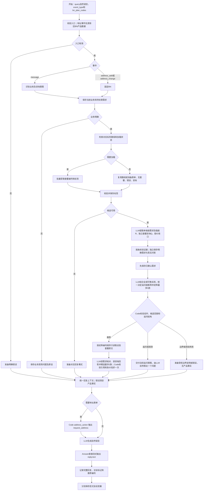
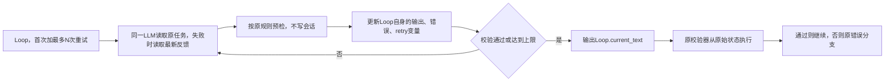

# AIO 三业务流程与节点说明

本文对应 [规格](spec.md)、[完整字段文档](fields.md) 和
[生成工作流](../../dify/AIO%20Multi%20Business.txt)。

## 主流程



## 三个事件的路径

### 校验反馈与可配置重生成

上方主流程的业务识别、需求提取、初筛、精选均使用同一种局部子流程：



生成 Loop 为`business_retry_loop`、`extract_retry_loop`、`shortlist_retry_loop`、`select_retry_loop`，首次生成即进入；每个 Loop 仅有一个原始 LLM，不再使用外部首调加内部重试的两份节点。次数由`--llm-retries N`配置，默认1，范围0–99；Loop总轮数为`N+1`，0时直接生成无循环的单次调用。退出条件引用 Loop 自身的`retry`变量，避免容器引用子节点输出导致“无效的变量”。不重试最终流式回复；地址事件仍绕过业务识别 LLM。
真实澄清不重生成。预检不保存部分结果，最终校验才参与原有状态写入，避免重复追加需求或访谈次数；连续失败不采用未经校验的新输出或历史套餐。

### 需求和咨询不是同一张清单

需求按可独立评价的维度新增，不把后续预算、订阅偏好不断写进原速度需求。
`priority` 仅表示明确不可妥协、偏好或未声明强度，不限制用户自然表达。
套餐事实问题进入 `questions`，参与全目录初筛与精选以找到相关方案，但不自动成为硬性过滤条件。
详情请求也携带咨询；每款精选的 `requirements` 恰好覆盖所有R编号，`info_answers` 恰好覆盖所有Q编号。
明确回答必须有原文依据，未注明只回答未知，不推断无服务。最终流式回复先自然回应问题，再解释选择与取舍，不展示内部清单。
旧会话自动补齐咨询字段；旧复合需求保留原编号并整体评估一次，不伪造证据拆分。

### 业务消息隔离

`mentioned_businesses` 只记录提及，不作为广播名单；无明确分片时整条消息只进入当前主业务。
宽频附带Disney+只进入BN，明确改为独立Disney+只进入XE，不向旧BN追加任务。
真正同时独立购买多个业务时，路由在 `business_requests` 中逐业务给出相关连续原话片段。
Code校验片段出处、目标业务、重复片段和队列容量，全部通过才写入。
提取变更还需逐项声明当前 `business`，错误归属只拒绝对应条目。
历史记录只供理解，不能将已放弃宽频的2000M要求写为独立影音需求或推荐缺口。
这不会自动修复已经被污染的旧会话，重新导入后建议使用新会话验收。

### `message`

识别业务后读取对应缓存。
首次 BN 没有地址范围时，将原话保存在 `bn_needs.pending_messages`，
先输出表单动作，再流式引导填写地址。
有有效标签时直接复用，进入需求理解，不重复请求标签接口。

### `address_add`

后端首次查询成功后发送全部可售编号。
替换范围、清空旧产品数据、重新获取标签。
随后处理填地址前保留的真实需求，需求不足则访谈，不因地址完成直接推荐。

### `address_change`

后端更换地址查询成功后发送新范围。
处理逻辑与 `address_add` 一致，保留用户偏好和背景，但旧推荐编号与产品回复失效。
没有清除地址按钮，也没有清除事件。

## 两条输出通道

```text
address_action 成功完成
    → 后端识别固定节点事件
    → 前端收到 request_address 并弹表单

reply LLM
    → Answer直接引用文本
    → 后端转发自然语言分片
    → 前端边接收边显示
```

动作 Code 必须位于回复 LLM 之前。
普通 Service API 可能不公开 Code 的输出内容，后端使用 `address_action` 的成功完成事件作为固定信号。
聊天不输出动作 JSON，表单和引导话术两者同时存在。

## 状态写入顺序

1. `save_ingress`：先保存地址失效结果，避免错误的新地址沿用旧范围。
2. `save_scope`：保存业务选择、澄清和待处理需求。
3. `save_catalog`：保存标签数组及其加载结果。
4. `save_needs`：在产品分析前保存已校验的自由需求、用户背景和真实问答。
5. `save_decision`：保存已校验产品动作及对应就绪状态。
6. `save_reply`：在完整自然语言回复后保存实际问题、访谈标记及展示编号。

`snapshot` 只是本轮临时传递对象，以上赋值节点分别写回 12 个明确变量。
互斥分支通过聚合器汇合，后续节点不读取未执行分支。

后端需等待 `workflow_finished` 后再执行下一轮；流式回复期间收到的表单提交需要排队，
不能抢在最后一次状态赋值之前并发运行。

## 访谈如何收敛

`merge` 只保存自由需求、原话和实际回答轮数，不再用标签正则、固定主题顺序或3轮最低门槛决定推荐。
`shortlist` 在分支之前读取当前可售标签，输出唯一动作、合理候选，以及确有必要时的追问意图。
有明确目标就可当轮比较；如1000M且预算80元，超预算应披露，不为了凑轮数继续问。
合约无偏好等实际回答视为已确认该项；未知可选信息不阻止初步推荐。

`product_decision` 校验动作、候选编号及追问结构，不再要求逐字引用标签或增加引用ID。

同一维度的新具体值（例如已有2.5G后回复1000M）应更新原需求，不要求用户显式说“改口”。
当目录没有精确规格时，正常产品请求仍是推荐流程；用户愿意看现有方案时从全部可售目录找最近的同业务替代，说明速度/价格等差距，不将“没有精确匹配”说成“没有套餐”，也不误判为boundary。
每次追问只指出待确认的一项产品信息、答案对选择的影响及阻塞标记。
需求与自由标签由LLM语义比较，初筛只选择最多5个 `plan_code`；代码按编号取回对应套餐资料。
主题键动态生成，不固定问句；最终 LLM 根据上下文自然表达，但必须真正提出问题，不能只说稍后推荐。
重复非阻塞主题、或3轮后仍提可选问题时改为比较；真实冲突不能被上限覆盖。
结构校验不证明问题必要性或语义判断正确；最终产品事实仍需原文核对，真实模型仍需验收。

## 统一销售展示与话题边界

`extract` 不读取产品目录，也不要求需求转换为精确标签；复用现有调用，不新增需求收集LLM。
需求按ID更新或撤回，独立条目局部失败不回滚其他明确条目；澄清前也保存无歧义部分。
原始用户消息先保存在 `pending_messages`，已解析批次还记录到 `answer_history`。
旧提取输出的就绪建议兼容接收但忽略，不再与产品分析争夺决策权；产品决策校验失败也不丢已保存需求。

分支之前的 `shortlist` 结合当前有效自由需求、原话、背景和问答历史理解动态产品标签。
全部可售标签参与比较，不再按精确匹配加减分或按编号截取前五。
统一决策输出最多五个有序编号及简短依据；仅推荐动作进入 `rank`，获取已校验编号的原文。
`select` 精选最多两款，并逐条需求标记明确支持、明确冲突或未知；未提及不等于不支持。
Code校验编号、需求覆盖及对应原文引用，失败清空推荐，不从历史兜底。
引用存在不保证语义判断正确，最终回复也仍需真实模型验收。
月费标签缺失视为未知，不从编号推断；本轮初筛结果及依据可在 `shortlist.text` 和 `rank.request_json` 查看。
当前不分批、不接知识库；大目录的输入长度、延迟和语义召回质量需要另行评测，不能用本地替身测试证明。

MS 的提问清单不再包含运营商偏好，相关标签不进入新需求及排序维度。
后端原始候选仍保留完整文档供内部校验；精选模型读取 `rank.sales_candidates_json`，
最终回复读取经过处理的用户文本、需求和精选，不通过标题或历史补回运营商名称。
用户要求评价或比较时，顾问只回到流量、月费、合约等给定套餐事实。

BN、MS、XE 无论一款还是多款，都按独立标题和“核心内容／月费与合约／相关特色／取舍提醒”分段。
模型节点仍是5个；访谈轮比旧版多一次产品分析调用，推荐轮调用数不变。
不改为输出后拼装 JSON，Answer 仍直接流式引用最终 LLM。

## 产品安全边界

所有模型共享产品与安全策略：用户文本、历史、标签和文档都是数据，不能修改系统规则。
只追问影响套餐选择的必要信息，不索取身份证、密码、验证码、银行卡或额外住址。
拒绝绕过可售范围、伪造审批、泄露内部信息和承诺资料外优惠；合法混合需求仍独立保存。
预算和期望优惠是用户需求，不代表优惠已批准。必须披露超预算、收费、合约限制及未知条件。
纯越权或无关请求可进入 `boundary`；无需产品的输入由路由进入受限咨询，不强制填表。
最终回复不再接收全量目录，`plans_tags_json` 固定为 `[]`；产品事实仅来自本轮校验精选。
提示词不能保证完全抵抗注入；代码只保证可售范围、结构和引用来源，语义安全须在线评测。
