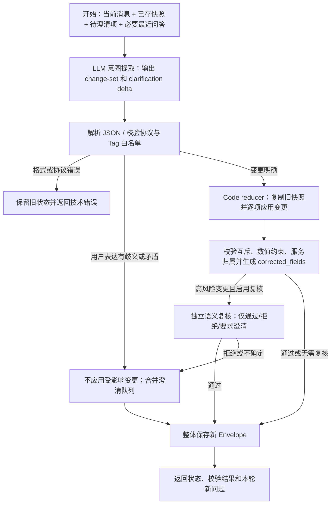

# BN/OTT 多轮需求提取工作流设计（已被新状态模型取代）

> 本文件描述的是旧版按业务分组、Required/Interested/Refused 的状态方案。当前实现改用扁平 Tag 与数值字段，并在提交查询前二次确认业务类别；以 [当前规格](spec.md) 和 [Dify Chatflow](../../dify/AIO%20Demo.txt) 为准。

## 目标

稳定理解当前轮用户表达，输出可校验的 Tag 变更；只更新明确涉及的字段，保留未提及的旧状态；存在真实歧义时追问，不猜测。持久化需求快照仍沿用现有 `conversation_state_json` Envelope 1.2，LLM 内部输出改为本轮变更协议。

## 流程图

## 节点职责

1. **意图提取**：输入当前消息、当前完整需求状态、待澄清问题和必要的最近问答。输出仅包含本轮新增/迁移/撤销/设置/清除操作及澄清增量；未提及字段不输出。每个操作包含用户原话证据。
2. **解析与协议校验**：检查 JSON 形状、必需字段、枚举值、Tag 白名单、业务与字段组合。当前实现失败时保留旧状态并报告技术错误；尚未接入格式修复重试。
3. **澄清处理**：只在用户表达确实歧义、矛盾或缺少关键口径时新建问题；代码保留未解决旧问题，验证被解决的问题 ID 来自旧队列。
4. **确定性 reducer**：基于旧快照复制出新快照，仅应用明确变更。Tag 状态迁移先清除同业务同 Tag 的旧状态，再写入目标状态；目标为 `null` 表示撤销，不自动转成其他强度。未涉及状态保持原样。
5. **一致性校验与审计**：检查 Required/Interested/Refused 互斥、`required_all`/`required_any` 互斥、数值字段合法、BN/OTT 字段归属正确。`corrected_fields` 由前后快照差异生成，不由 LLM 提供或授权。
6. **可选语义复核**：仅用于撤销业务、重要数值替换、跨 BN/OTT 迁移等高风险变更。复核模型不得改写需求，只返回通过、拒绝或澄清；不确定时不提交受影响变更。
7. **保存与响应**：所有校验通过后一次性保存 Envelope 1.2。技术错误保留旧状态并返回具体错误；不能伪装成用户冲突问题。

## LLM 变更协议

- `schema_version`: 固定为 `2.0`（仅内部提取协议，不改变持久化 Envelope 版本）。
- `service_changes[]`: 仅包含明确的业务 `confirm` / `retract` 操作。
- `tag_changes[]`: 每项包含 `service`、`field`、`tag`、目标 `to` 和 `evidence`。`to` 允许 `required_all`、`required_any`、`interested`、`refused`、`null`。
- `scene_changes[]`: 只允许 `interested` 或 `null`。
- `constraint_changes[]`: 包含业务、数值字段、`strength`、`to` 和 `evidence`；`to:null` 表示清除约束。
- `clarification_changes`: 包含本轮 `add[]` 和 `resolve_ids[]`；Code 生成问题 ID，并保留未解决旧问题。
- 格式合法不代表语义必然正确。代码可验证证据是否来自当前消息、字段是否合法，但语义仍由提取模型判断；无法确定时应输出澄清而非猜测。

## 本轮示例

“Netflix 不用必须有了，但不要 Disney+”应提取为：BN `bundled_services` 中 Netflix 目标状态为 `null`，Disney+ 目标状态为 `refused`。Wi-Fi 7 未被本轮提及，因此不输出操作，由 reducer 原样保留。

## 回归验收重点

覆盖首次新增、Required 撤销、强度迁移、明确拒绝、数值替换、Wi-Fi 等互斥等级、BN 权益与 OTT 独立订阅区分、指代和省略、澄清回答、技术格式错误。验收既检查操作，也逐轮比较最终完整状态；所有未提及字段必须保持不变。当前暂未实现独立 LLM 语义复核；它是后续可选的高风险防线，不是当前提交路径的一部分。
